# Main-map landscape prompts (map-accurate)

Generated by `tools/landscape-guides/render.py --prompts` from `views.json`. Edit cameras and text there, not here.

Each landscape is the view from a real spot on the main map, so the sea, cliffs, islands and buildings are where the map says they are, and neighbouring regions agree with each other.

## How to use

1. **With image input (preferred):** attach the region's guide render (`landscape-guides/<id>.png`) and paste:
   > Repaint this rough 3D layout as a finished, detailed pixel art landscape. Keep the composition exactly: the horizon height, and where the sea, cliffs, forest, buildings and islands sit in the frame. Replace the blocky shapes and stretched textures with proper detailed art.
   Then paste the region's prompt below.
2. **Text only:** paste the region's prompt. The composition text describes the same layout as the guide.
3. Ship as **960×540 JPG** (generated on a 480×270 pixel grid) at `static/locations/<id>.jpg`. Each region gets its own file; `landscapeDefinitions.ts` gets repointed once they exist.

## World bible (keep these consistent across every image)

- **Sylvie's cottage**: a cottage with white stone walls, a bright red rounded roof and blue-framed windows.
- **Pleasure Island**: a small tropical island ringed by sheer lavender-grey cliffs, with red-leaved palm trees and stone torches on top.
- **the central plateau**: terraced lavender-grey stone cliffs with grassy ledges and pine forest, rising in the middle of the main island.
- **Veres' mesa**: a flat-topped mound of brown earth with grass on top.
- **the red extractor**: an industrial machine with a teal roof and a red body standing on the beach, with a dark metal pipe scaffold running out into the sea.
- **the ruined dragon shrine**: grey stone walls and pillars with stone dragon statues, overgrown with ivy.
- **the glacier island**: an island of white snowfields and tiers of pale-blue ice cliffs, with dark stone pillars.
- **the black-sailed galleon**: a large wooden galleon with black sails.
- **the white-sailed ship**: a smaller wooden ship with white sails.
- **Palette**: vivid green grass, lavender-grey rock, pale sand, deep-blue sea with turquoise shallows.

## Regions

### shallow_water

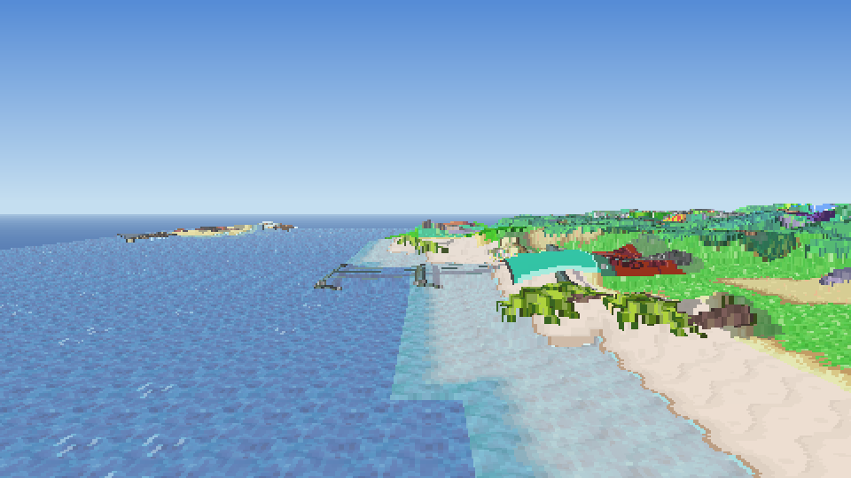

Camera: tile (10, 23), facing east. Mood: clear.

```
16-bit SNES-era pixel art landscape, crisp hard-edged pixels, limited palette (~48 colours), soft atmospheric depth, JRPG overworld mood, seen from a slightly raised vantage point, no characters, no people, no text, no UI, no watermark, 16:9. Standing in turquoise shallows off the north beach, looking east along the coast. Left half: open deep-blue sea to the horizon. Right half: a long pale-sand beach curving away into the distance with palm trees behind it; further along the shore, the red extractor and its pipe scaffold reaching into the sea. Far right: green forest canopy rising inland. (the red extractor is an industrial machine with a teal roof and a red body standing on the beach, with a dark metal pipe scaffold running out into the sea.) Palette: vivid green grass, lavender-grey rock, pale sand, deep-blue sea with turquoise shallows. Lighting: bright clear late-morning light, soft shadows, a few white clouds.
```

### north_beach

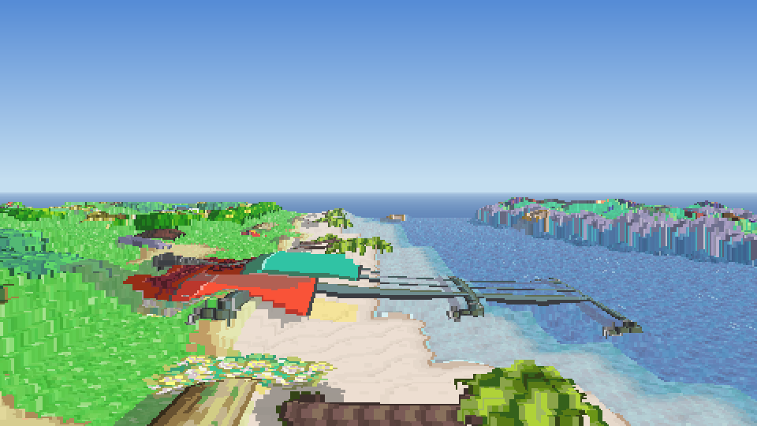

Camera: tile (44, 25), facing west. Mood: clear.

```
16-bit SNES-era pixel art landscape, crisp hard-edged pixels, limited palette (~48 colours), soft atmospheric depth, JRPG overworld mood, seen from a slightly raised vantage point, no characters, no people, no text, no UI, no watermark, 16:9. On the sand of a long beach, looking west along the shoreline. Centre and right: the sea, turquoise near the shore and deep blue beyond; on the far-right horizon, Pleasure Island. Left midground: the red extractor and its pipe scaffold out over the shallows, palm trees and a driftwood log on the sand. Left edge: green meadow inland. (Pleasure Island is a small tropical island ringed by sheer lavender-grey cliffs, with red-leaved palm trees and stone torches on top; the red extractor is an industrial machine with a teal roof and a red body standing on the beach, with a dark metal pipe scaffold running out into the sea.) Palette: vivid green grass, lavender-grey rock, pale sand, deep-blue sea with turquoise shallows. Lighting: bright clear late-morning light, soft shadows, a few white clouds.
```

### arrival_plains

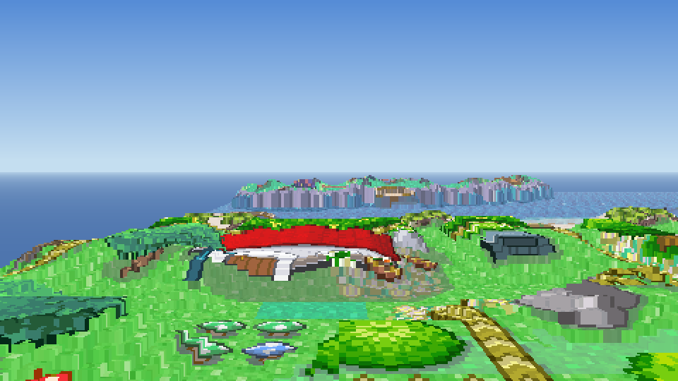

Camera: tile (8, 50), facing north. Mood: clear.

```
16-bit SNES-era pixel art landscape, crisp hard-edged pixels, limited palette (~48 colours), soft atmospheric depth, JRPG overworld mood, seen from a slightly raised vantage point, no characters, no people, no text, no UI, no watermark, 16:9. A grassy meadow looking north. Centre midground: Sylvie's cottage inside a low wooden picket fence, a small garden and a few giant mushrooms in front, pine trees either side. Behind it a pale beach, then the sea; on the horizon centre-left, Pleasure Island. Foreground: open grass and a round green bush. (Sylvie's cottage is a cottage with white stone walls, a bright red rounded roof and blue-framed windows; Pleasure Island is a small tropical island ringed by sheer lavender-grey cliffs, with red-leaved palm trees and stone torches on top.) Palette: vivid green grass, lavender-grey rock, pale sand, deep-blue sea with turquoise shallows. Lighting: bright clear late-morning light, soft shadows, a few white clouds.
```

### forest1

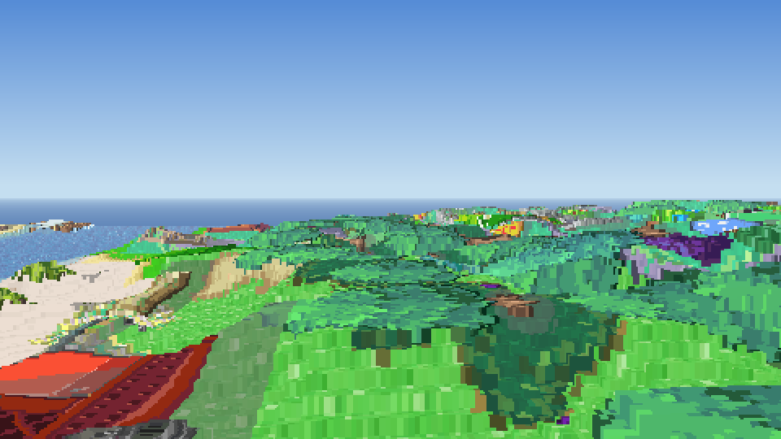

Camera: tile (24, 33), facing east. Mood: clear.

```
16-bit SNES-era pixel art landscape, crisp hard-edged pixels, limited palette (~48 colours), soft atmospheric depth, JRPG overworld mood, seen from a slightly raised vantage point, no characters, no people, no text, no UI, no watermark, 16:9. At the western edge of a dense forest, looking east into it. Left: a sandy path and the red extractor's roof toward the beach. Centre and right: a thick canopy of rounded deciduous and pine trees stretching away, giant red-capped and blue mushrooms between the trunks, the ground rising gently toward the central plateau. Far right: grey stone ruins above the treeline. (the central plateau is terraced lavender-grey stone cliffs with grassy ledges and pine forest, rising in the middle of the main island; the red extractor is an industrial machine with a teal roof and a red body standing on the beach, with a dark metal pipe scaffold running out into the sea.) Palette: vivid green grass, lavender-grey rock, pale sand, deep-blue sea with turquoise shallows. Lighting: bright clear late-morning light, soft shadows, a few white clouds.
```

### murky_water

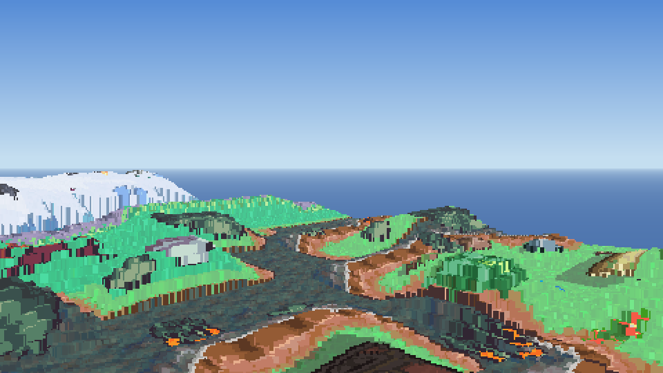

Camera: tile (16, 51), facing southwest. Mood: overcast.

```
16-bit SNES-era pixel art landscape, crisp hard-edged pixels, limited palette (~48 colours), soft atmospheric depth, JRPG overworld mood, seen from a slightly raised vantage point, no characters, no people, no text, no UI, no watermark, 16:9. Looking down into a sunken swamp: dark still pools with lily pads and cattails, divided by raised grassy banks with crumbling stone ledges, gnarled dark swamp trees and a dead red tree, a wooden chest on a small islet. Beyond, the land ends in low cliffs; on the far-left horizon across the sea, the glacier island. (the glacier island is an island of white snowfields and tiers of pale-blue ice cliffs, with dark stone pillars.) Palette: vivid green grass, lavender-grey rock, pale sand, deep-blue sea with turquoise shallows. Lighting: soft overcast light, muted colours, low grey clouds.
```

### veres_hill

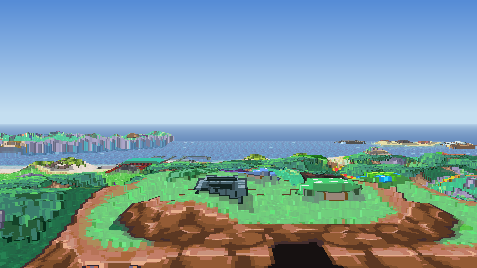

Camera: tile (36, 52), facing north. Mood: clear.

```
16-bit SNES-era pixel art landscape, crisp hard-edged pixels, limited palette (~48 colours), soft atmospheric depth, JRPG overworld mood, seen from a slightly raised vantage point, no characters, no people, no text, no UI, no watermark, 16:9. On a high stone plateau, looking north at Veres' mesa rising straight ahead: a dark cave mouth at its base, a wooden ladder up its side, a small campfire nearby. Left and right: lavender-grey stone terraces and pine trees. Far beyond, the forest falls away to the north coast and the sea, with Pleasure Island on the far-left horizon. (Pleasure Island is a small tropical island ringed by sheer lavender-grey cliffs, with red-leaved palm trees and stone torches on top; Veres' mesa is a flat-topped mound of brown earth with grass on top.) Palette: vivid green grass, lavender-grey rock, pale sand, deep-blue sea with turquoise shallows. Lighting: bright clear late-morning light, soft shadows, a few white clouds.
```

### south_land

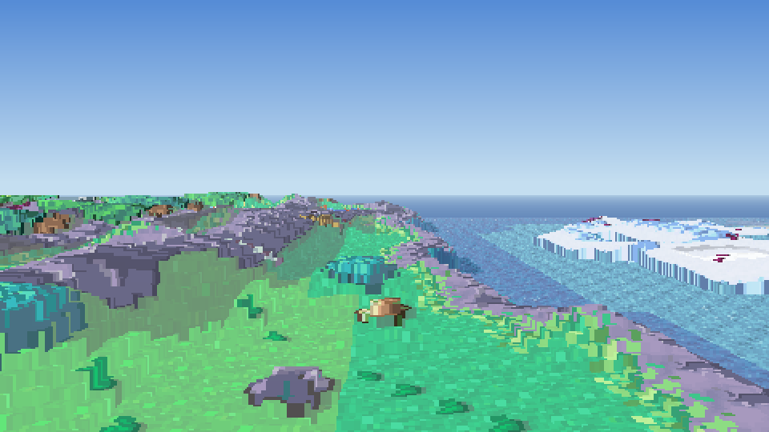

Camera: tile (20, 62), facing east. Mood: clear.

```
16-bit SNES-era pixel art landscape, crisp hard-edged pixels, limited palette (~48 colours), soft atmospheric depth, JRPG overworld mood, seen from a slightly raised vantage point, no characters, no people, no text, no UI, no watermark, 16:9. A southern lowland meadow, looking east. Left: the land climbs in the central plateau's terraced cliffs, topped with pine forest. Centre: rolling green meadow with scattered boulders running toward the coast. Right: low cliffs drop to the sea; across the water, the glacier island. (the central plateau is terraced lavender-grey stone cliffs with grassy ledges and pine forest, rising in the middle of the main island; the glacier island is an island of white snowfields and tiers of pale-blue ice cliffs, with dark stone pillars.) Palette: vivid green grass, lavender-grey rock, pale sand, deep-blue sea with turquoise shallows. Lighting: bright clear late-morning light, soft shadows, a few white clouds.
```

### unknown_hills

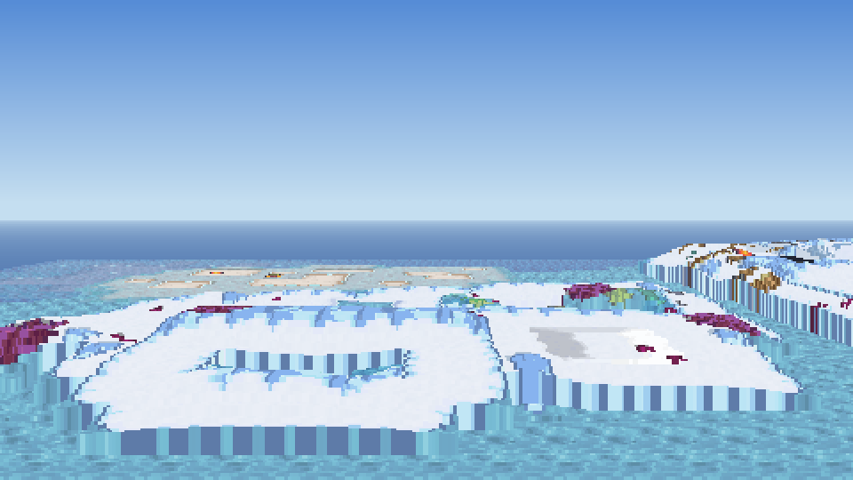

Camera: tile (43, 60), facing south. Mood: clear.

```
16-bit SNES-era pixel art landscape, crisp hard-edged pixels, limited palette (~48 colours), soft atmospheric depth, JRPG overworld mood, seen from a slightly raised vantage point, no characters, no people, no text, no UI, no watermark, 16:9. On a high rocky hillside at the south edge of the main island, looking south over the sea. Foreground: lavender-grey rock and sparse grass falling away. Midground: across a channel of turquoise water, a snow-covered island with blue ice cliffs and a frozen pool ringed by ice. Far right: more of the glacier coast. Palette: vivid green grass, lavender-grey rock, pale sand, deep-blue sea with turquoise shallows. Lighting: bright clear late-morning light, soft shadows, a few white clouds.
```

### mountain_forest

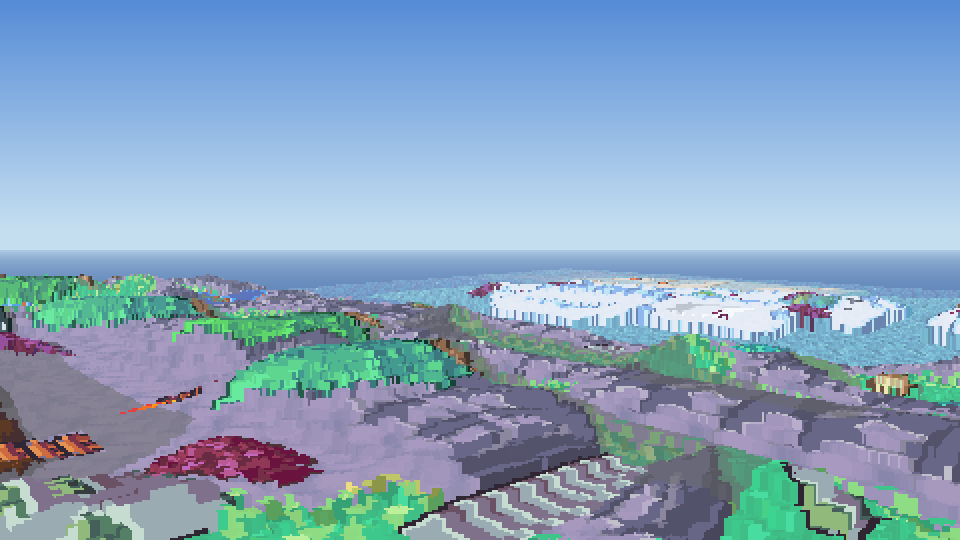

Camera: tile (25, 46), facing southeast. Mood: clear.

```
16-bit SNES-era pixel art landscape, crisp hard-edged pixels, limited palette (~48 colours), soft atmospheric depth, JRPG overworld mood, seen from a slightly raised vantage point, no characters, no people, no text, no UI, no watermark, 16:9. Mountain forest on the western slopes of the central plateau, looking southeast. Foreground: lavender-grey stone terraces, carved stone stairs leading down, purple-leaved shrubs. Midground: pine trees and grassy ledges stepping down. Far: the sea, and the glacier island on the horizon. (the central plateau is terraced lavender-grey stone cliffs with grassy ledges and pine forest, rising in the middle of the main island; the glacier island is an island of white snowfields and tiers of pale-blue ice cliffs, with dark stone pillars.) Palette: vivid green grass, lavender-grey rock, pale sand, deep-blue sea with turquoise shallows. Lighting: bright clear late-morning light, soft shadows, a few white clouds.
```

### stormy_water

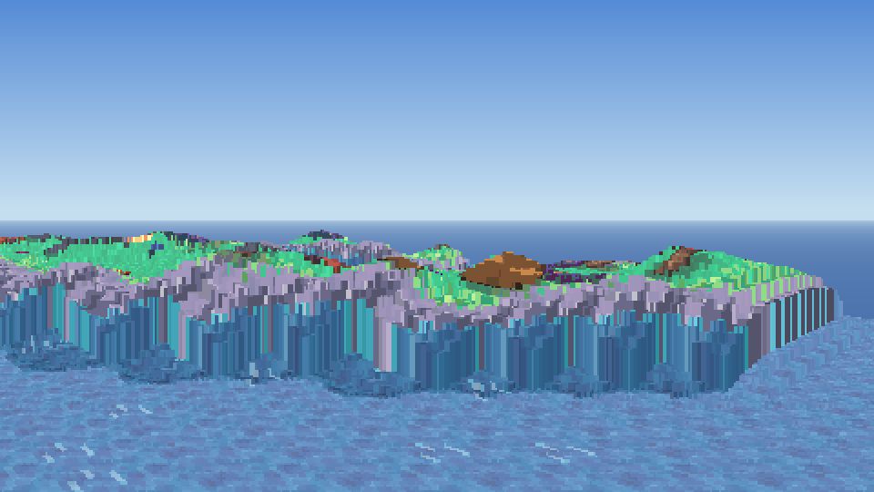

Camera: tile (30, 18), facing northwest. Mood: storm.

```
16-bit SNES-era pixel art landscape, crisp hard-edged pixels, limited palette (~48 colours), soft atmospheric depth, JRPG overworld mood, seen from a slightly raised vantage point, no characters, no people, no text, no UI, no watermark, 16:9. Out on open sea in a violent storm, looking northwest. Huge dark waves in the foreground. Midground: Pleasure Island, its cliffs lashed by surf, a rowing boat tied at its foot. Dark storm clouds, lightning, sheets of rain. (Pleasure Island is a small tropical island ringed by sheer lavender-grey cliffs, with red-leaved palm trees and stone torches on top.) Palette: vivid green grass, lavender-grey rock, pale sand, deep-blue sea with turquoise shallows. Lighting: dark storm, lightning, heavy rain, dramatic contrast.
```

### northeastern_sea

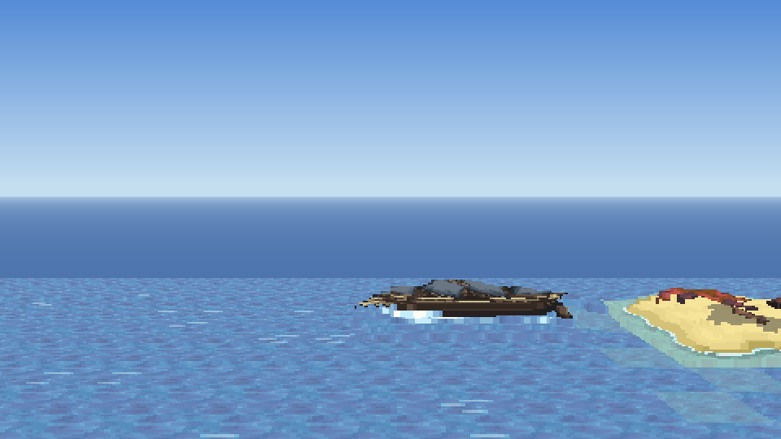

Camera: tile (50, 16), facing north. Mood: clear.

```
16-bit SNES-era pixel art landscape, crisp hard-edged pixels, limited palette (~48 colours), soft atmospheric depth, JRPG overworld mood, seen from a slightly raised vantage point, no characters, no people, no text, no UI, no watermark, 16:9. Open sea looking north. Centre-right midground: the black-sailed galleon at anchor; to its right, a tiny sandy islet with a palm tree. Calm deep-blue water, a distant horizon. (the black-sailed galleon is a large wooden galleon with black sails.) Palette: vivid green grass, lavender-grey rock, pale sand, deep-blue sea with turquoise shallows. Lighting: bright clear late-morning light, soft shadows, a few white clouds.
```

### south_coast

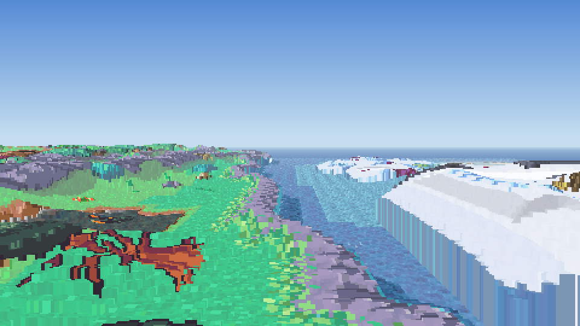

Camera: tile (5, 67), facing east. Mood: drizzle.

```
16-bit SNES-era pixel art landscape, crisp hard-edged pixels, limited palette (~48 colours), soft atmospheric depth, JRPG overworld mood, seen from a slightly raised vantage point, no characters, no people, no text, no UI, no watermark, 16:9. On a clifftop path along the southern coast, looking east. Left: green coastal meadow with a dead red tree; inland, the terraced cliffs of the central plateau. Right: the cliff edge drops to a channel of sea; across it, the towering white wall of the glacier island. (the central plateau is terraced lavender-grey stone cliffs with grassy ledges and pine forest, rising in the middle of the main island; the glacier island is an island of white snowfields and tiers of pale-blue ice cliffs, with dark stone pillars.) Palette: vivid green grass, lavender-grey rock, pale sand, deep-blue sea with turquoise shallows. Lighting: grey overcast sky, light drizzle, damp muted colours.
```

### glacier_bottom

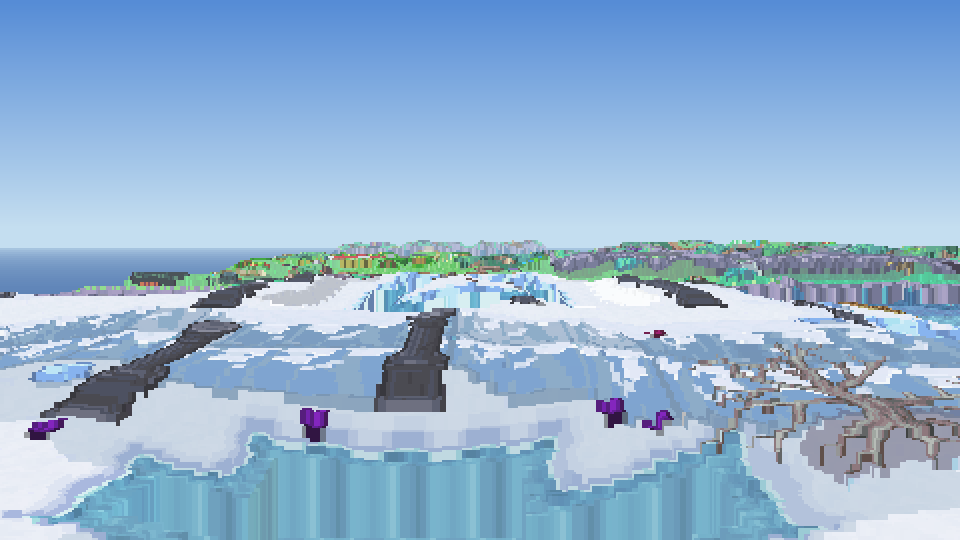

Camera: tile (18, 97), facing north. Mood: crisp.

```
16-bit SNES-era pixel art landscape, crisp hard-edged pixels, limited palette (~48 colours), soft atmospheric depth, JRPG overworld mood, seen from a slightly raised vantage point, no characters, no people, no text, no UI, no watermark, 16:9. At the foot of the glacier, looking north up its terraces: walls of pale blue ice cliffs, snowfields with dark stone obelisks and a bare dead tree, small purple frost flowers. Far: the green main island across the sea. Palette: vivid green grass, lavender-grey rock, pale sand, deep-blue sea with turquoise shallows. Lighting: crisp cold clear light, pale blue sky, sparkling snow.
```

### glacier_top

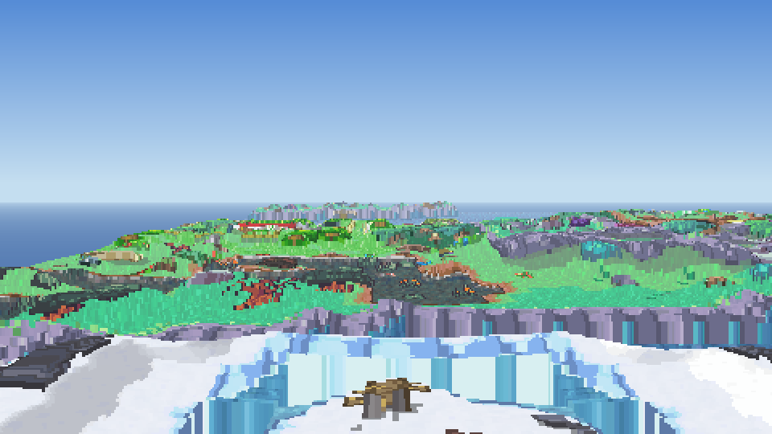

Camera: tile (17, 82), facing north. Mood: crisp.

```
16-bit SNES-era pixel art landscape, crisp hard-edged pixels, limited palette (~48 colours), soft atmospheric depth, JRPG overworld mood, seen from a slightly raised vantage point, no characters, no people, no text, no UI, no watermark, 16:9. On the glacier summit, looking north. Foreground: a frozen moat ringed with ice crystals around a small snowy islet with a golden ankh-shaped shrine. Beyond the glacier's ice-cliff edge and across a channel: the green main island, its swamp, meadows and the central plateau. (the central plateau is terraced lavender-grey stone cliffs with grassy ledges and pine forest, rising in the middle of the main island.) Palette: vivid green grass, lavender-grey rock, pale sand, deep-blue sea with turquoise shallows. Lighting: crisp cold clear light, pale blue sky, sparkling snow.
```

### icy_coast_south

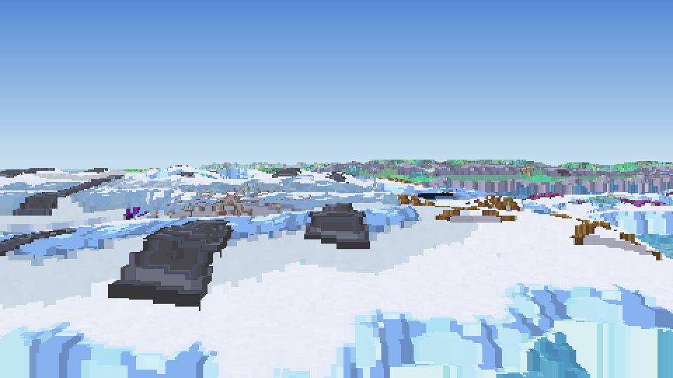

Camera: tile (25, 100), facing north. Mood: crisp.

```
16-bit SNES-era pixel art landscape, crisp hard-edged pixels, limited palette (~48 colours), soft atmospheric depth, JRPG overworld mood, seen from a slightly raised vantage point, no characters, no people, no text, no UI, no watermark, 16:9. From the sea off the glacier island's south coast, looking north at it: jagged blue ice cliffs rising from turquoise water, snowfields above with dark stone pillars, and a camp with a campfire and wooden barricades at the mouth of an ice cave. (the glacier island is an island of white snowfields and tiers of pale-blue ice cliffs, with dark stone pillars.) Palette: vivid green grass, lavender-grey rock, pale sand, deep-blue sea with turquoise shallows. Lighting: crisp cold clear light, pale blue sky, sparkling snow.
```

### unknown_islands

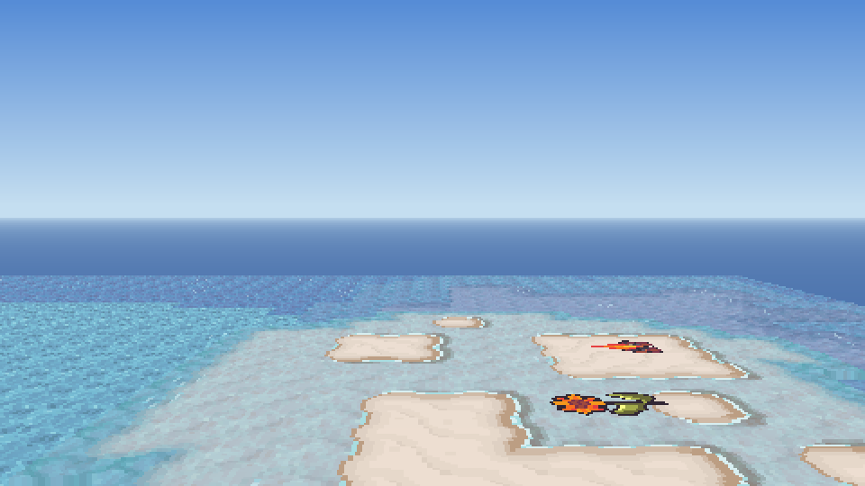

Camera: tile (42, 88), facing east. Mood: clear.

```
16-bit SNES-era pixel art landscape, crisp hard-edged pixels, limited palette (~48 colours), soft atmospheric depth, JRPG overworld mood, seen from a slightly raised vantage point, no characters, no people, no text, no UI, no watermark, 16:9. Turquoise shallows dotted with small flat sandbar islets: one with a single tall orange sunflower, another with a campfire. Calm clear water, open-sea horizon. Palette: vivid green grass, lavender-grey rock, pale sand, deep-blue sea with turquoise shallows. Lighting: bright clear late-morning light, soft shadows, a few white clouds.
```

### deserted_island

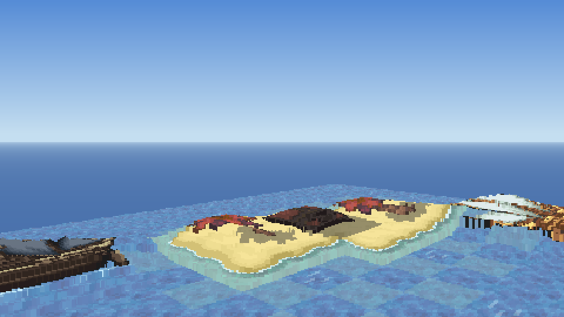

Camera: tile (50, 13), facing northeast. Mood: clear.

```
16-bit SNES-era pixel art landscape, crisp hard-edged pixels, limited palette (~48 colours), soft atmospheric depth, JRPG overworld mood, seen from a slightly raised vantage point, no characters, no people, no text, no UI, no watermark, 16:9. From the water, looking at a tiny deserted island: pale sand, two red-leaved palm trees, a large wooden treasure chest. The black-sailed galleon anchored to its left, the white-sailed ship to its right. (the black-sailed galleon is a large wooden galleon with black sails; the white-sailed ship is a smaller wooden ship with white sails.) Palette: vivid green grass, lavender-grey rock, pale sand, deep-blue sea with turquoise shallows. Lighting: bright clear late-morning light, soft shadows, a few white clouds.
```

### mountain_forest2

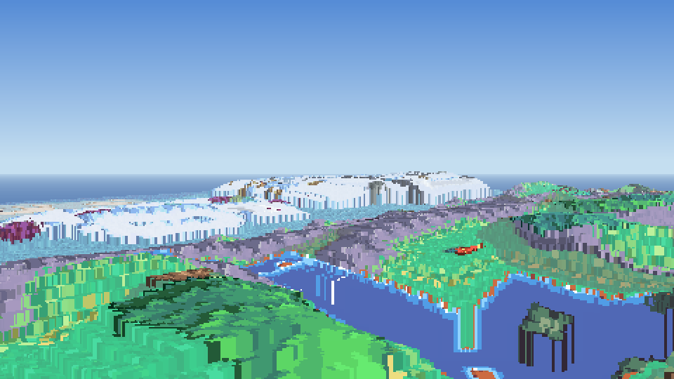

Camera: tile (58, 47), facing southwest. Mood: clear.

```
16-bit SNES-era pixel art landscape, crisp hard-edged pixels, limited palette (~48 colours), soft atmospheric depth, JRPG overworld mood, seen from a slightly raised vantage point, no characters, no people, no text, no UI, no watermark, 16:9. Upper mountain forest by a river, looking southwest. Foreground: thick pine canopy. Midground: a blue river pool with lily pads winding between grassy banks, lavender-grey rock, a stone pillar. Far: across the sea, the glacier island. (the glacier island is an island of white snowfields and tiers of pale-blue ice cliffs, with dark stone pillars.) Palette: vivid green grass, lavender-grey rock, pale sand, deep-blue sea with turquoise shallows. Lighting: bright clear late-morning light, soft shadows, a few white clouds.
```

### dragon_shrine_grounds

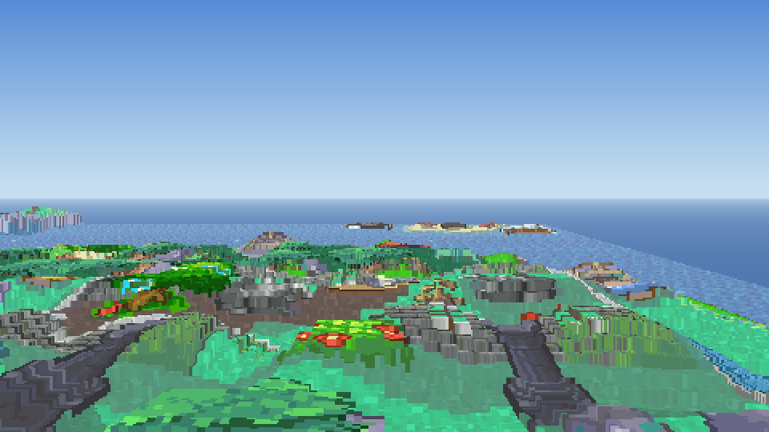

Camera: tile (53, 50), facing north. Mood: clear.

```
16-bit SNES-era pixel art landscape, crisp hard-edged pixels, limited palette (~48 colours), soft atmospheric depth, JRPG overworld mood, seen from a slightly raised vantage point, no characters, no people, no text, no UI, no watermark, 16:9. Looking north across the grounds of the ruined dragon shrine: crumbling grey stone walls with arched windows, broken pillars, stone dragon statues flanking a golden ankh, a ruined stone building with a blue tiled roof on the right, ivy and red flowers everywhere. Beyond, forest and the northern sea. (the ruined dragon shrine is grey stone walls and pillars with stone dragon statues, overgrown with ivy.) Palette: vivid green grass, lavender-grey rock, pale sand, deep-blue sea with turquoise shallows. Lighting: bright clear late-morning light, soft shadows, a few white clouds.
```

### mountain_east

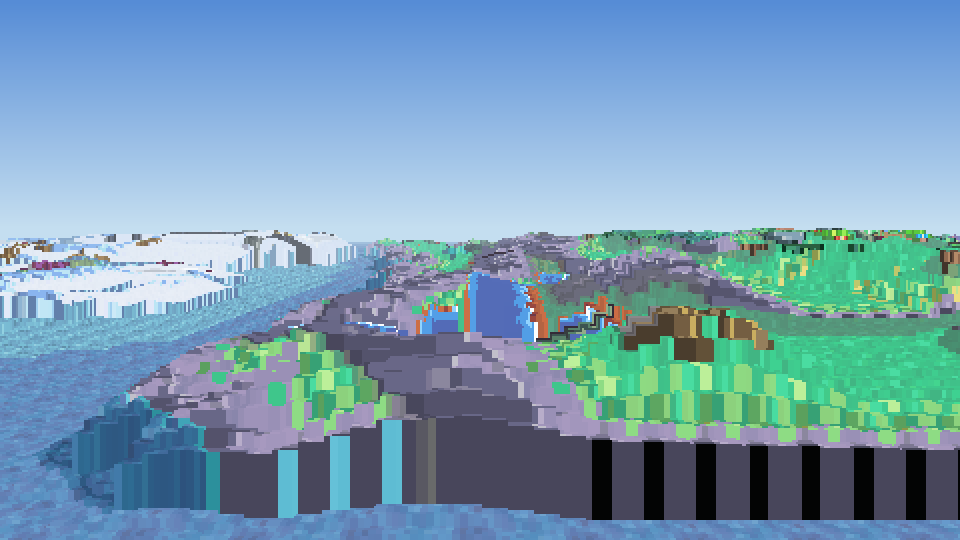

Camera: tile (70, 60), facing west. Mood: clear.

```
16-bit SNES-era pixel art landscape, crisp hard-edged pixels, limited palette (~48 colours), soft atmospheric depth, JRPG overworld mood, seen from a slightly raised vantage point, no characters, no people, no text, no UI, no watermark, 16:9. From the sea east of the main island, looking west at its eastern cliffs: tall lavender-grey rock faces, a waterfall pouring from the cliff into the sea, pine forest on top. To the left, the south coast and a glimpse of the glacier island. (the glacier island is an island of white snowfields and tiers of pale-blue ice cliffs, with dark stone pillars.) Palette: vivid green grass, lavender-grey rock, pale sand, deep-blue sea with turquoise shallows. Lighting: bright clear late-morning light, soft shadows, a few white clouds.
```

### waterfall

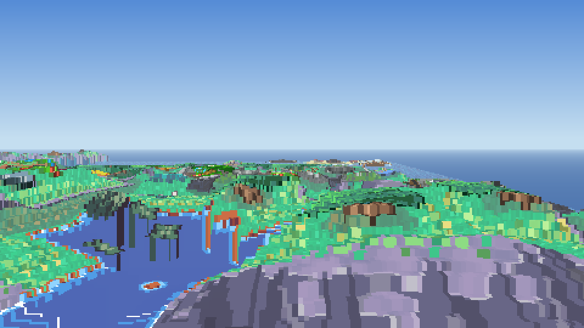

Camera: tile (53, 62), facing north. Mood: clear.

```
16-bit SNES-era pixel art landscape, crisp hard-edged pixels, limited palette (~48 colours), soft atmospheric depth, JRPG overworld mood, seen from a slightly raised vantage point, no characters, no people, no text, no UI, no watermark, 16:9. At the foot of a waterfall in mountain forest, looking north: a wide waterfall dropping over lavender-grey cliffs into a pool, a winding blue river above with lily pads, pines along the ledges, and the ruined shrine's stone building visible on the right-hand ledge. Palette: vivid green grass, lavender-grey rock, pale sand, deep-blue sea with turquoise shallows. Lighting: bright clear late-morning light, soft shadows, a few white clouds.
```

### ice_spring

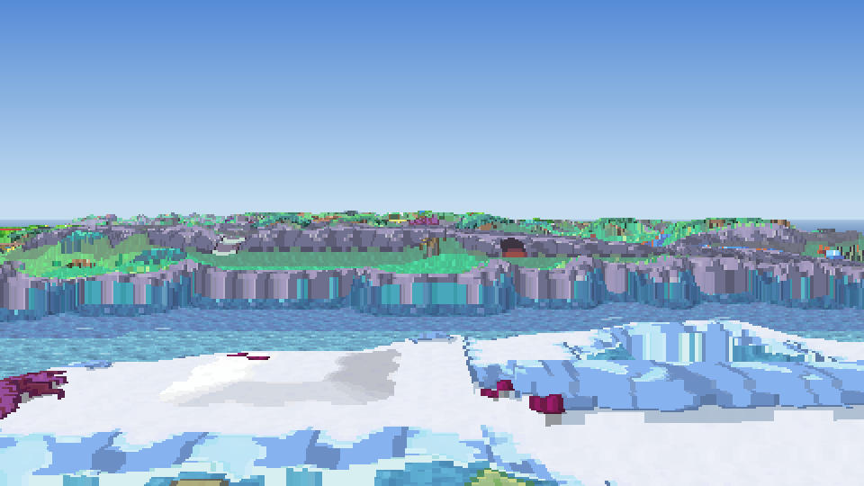

Camera: tile (41, 83), facing north. Mood: crisp.

```
16-bit SNES-era pixel art landscape, crisp hard-edged pixels, limited palette (~48 colours), soft atmospheric depth, JRPG overworld mood, seen from a slightly raised vantage point, no characters, no people, no text, no UI, no watermark, 16:9. Close to a frozen spring on a small ice island, looking north: a still pool of turquoise water ringed by ice crystals in the foreground, snowfields and small purple frost plants around it. Across a channel, the main island's south cliffs, green on top. Palette: vivid green grass, lavender-grey rock, pale sand, deep-blue sea with turquoise shallows. Lighting: crisp cold clear light, pale blue sky, sparkling snow.
```

### eastern_sea

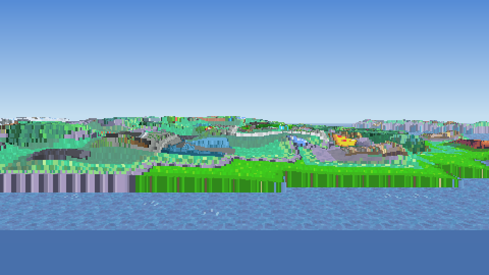

Camera: tile (76, 40), facing west. Mood: clear.

```
16-bit SNES-era pixel art landscape, crisp hard-edged pixels, limited palette (~48 colours), soft atmospheric depth, JRPG overworld mood, seen from a slightly raised vantage point, no characters, no people, no text, no UI, no watermark, 16:9. Open sea looking west at the main island's east coast: low grassy cliffs, the ruined shrine with grey stone walls and a blue-roofed building, forest and a river behind it, the central plateau rising in the middle distance. (the central plateau is terraced lavender-grey stone cliffs with grassy ledges and pine forest, rising in the middle of the main island.) Palette: vivid green grass, lavender-grey rock, pale sand, deep-blue sea with turquoise shallows. Lighting: bright clear late-morning light, soft shadows, a few white clouds.
```

### icy_mountain_top

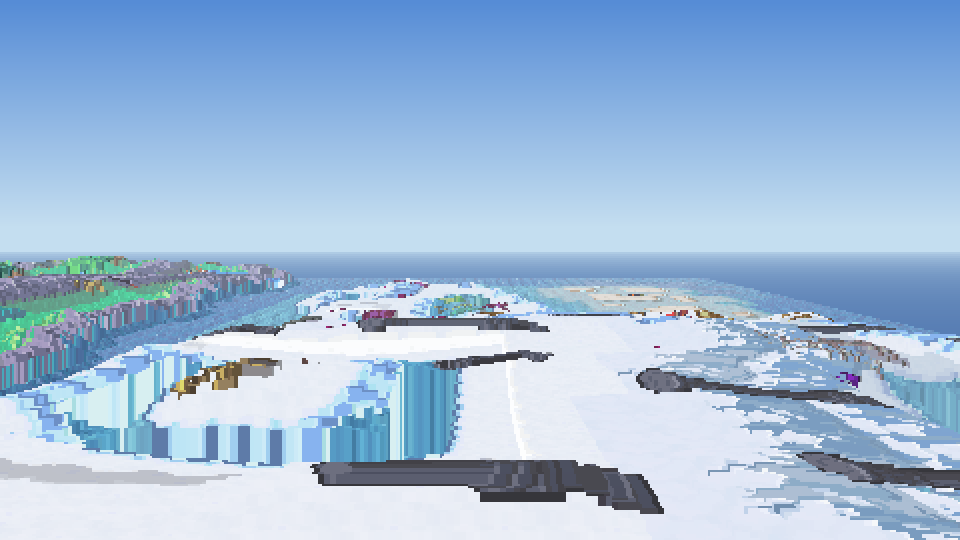

Camera: tile (5, 80), facing east. Mood: crisp.

```
16-bit SNES-era pixel art landscape, crisp hard-edged pixels, limited palette (~48 colours), soft atmospheric depth, JRPG overworld mood, seen from a slightly raised vantage point, no characters, no people, no text, no UI, no watermark, 16:9. On a high snowy plateau of the glacier island, looking east: an open snowfield, dark stone pillars and fallen columns, ice ridges and blue ice cliffs dropping toward the sea on the left; the green main island on the horizon. (the glacier island is an island of white snowfields and tiers of pale-blue ice cliffs, with dark stone pillars.) Palette: vivid green grass, lavender-grey rock, pale sand, deep-blue sea with turquoise shallows. Lighting: crisp cold clear light, pale blue sky, sparkling snow.
```

### icy_mountain

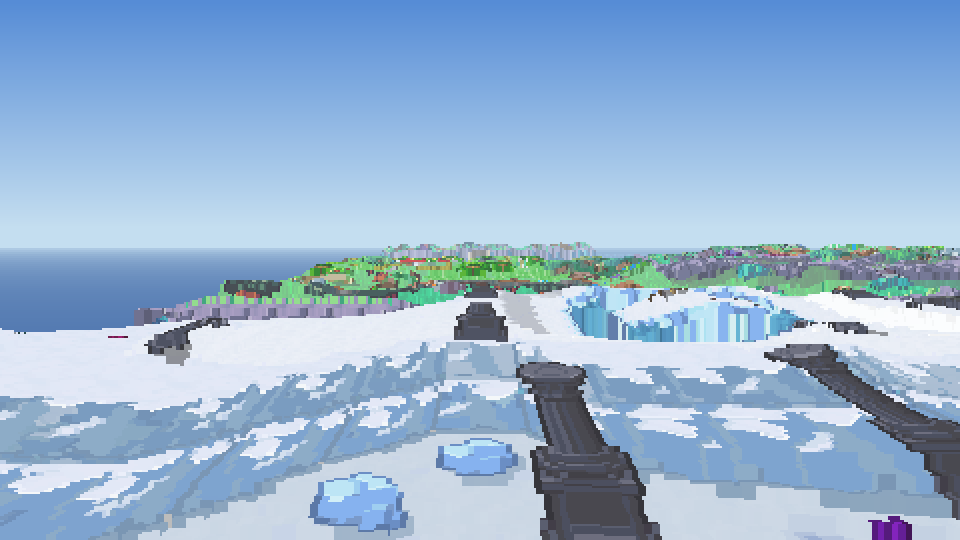

Camera: tile (12, 94), facing north. Mood: crisp.

```
16-bit SNES-era pixel art landscape, crisp hard-edged pixels, limited palette (~48 colours), soft atmospheric depth, JRPG overworld mood, seen from a slightly raised vantage point, no characters, no people, no text, no UI, no watermark, 16:9. Snowy slopes of the glacier island, looking north: terraced snowfields, blue ice cliffs, dark stone pillars lining a path, ice boulders, a lit torch. Far: the sea and the main island. (the glacier island is an island of white snowfields and tiers of pale-blue ice cliffs, with dark stone pillars.) Palette: vivid green grass, lavender-grey rock, pale sand, deep-blue sea with turquoise shallows. Lighting: crisp cold clear light, pale blue sky, sparkling snow.
```

### cold_waters

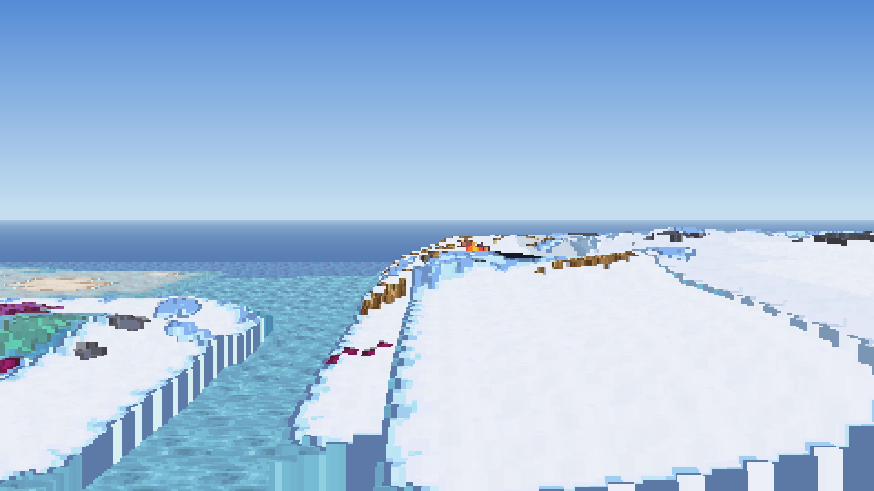

Camera: tile (30, 70), facing south. Mood: overcast.

```
16-bit SNES-era pixel art landscape, crisp hard-edged pixels, limited palette (~48 colours), soft atmospheric depth, JRPG overworld mood, seen from a slightly raised vantage point, no characters, no people, no text, no UI, no watermark, 16:9. On cold, choppy turquoise water between islands, looking south. Right: the towering ice cliffs of the glacier island. Left: distant sandbar islets. Pale overcast sky. (the glacier island is an island of white snowfields and tiers of pale-blue ice cliffs, with dark stone pillars.) Palette: vivid green grass, lavender-grey rock, pale sand, deep-blue sea with turquoise shallows. Lighting: soft overcast light, muted colours, low grey clouds.
```

### southeastern_sea

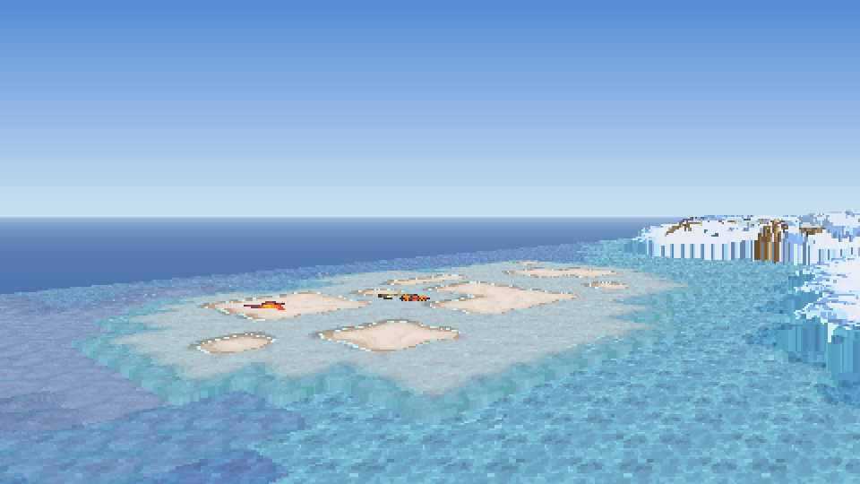

Camera: tile (62, 78), facing southwest. Mood: clear.

```
16-bit SNES-era pixel art landscape, crisp hard-edged pixels, limited palette (~48 colours), soft atmospheric depth, JRPG overworld mood, seen from a slightly raised vantage point, no characters, no people, no text, no UI, no watermark, 16:9. Open sea looking southwest: a cluster of flat sandbars in turquoise shallows in the midground, and the white edge of the glacier island on the far right. (the glacier island is an island of white snowfields and tiers of pale-blue ice cliffs, with dark stone pillars.) Palette: vivid green grass, lavender-grey rock, pale sand, deep-blue sea with turquoise shallows. Lighting: bright clear late-morning light, soft shadows, a few white clouds.
```

### ice_spring_island

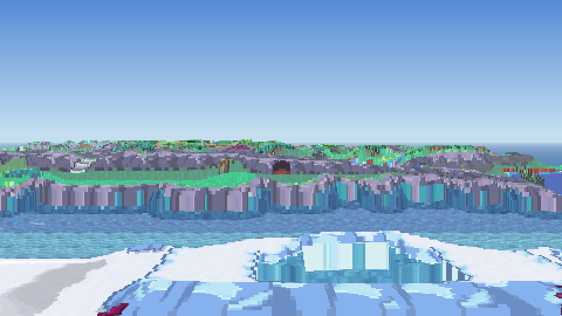

Camera: tile (44, 81), facing north. Mood: crisp.

```
16-bit SNES-era pixel art landscape, crisp hard-edged pixels, limited palette (~48 colours), soft atmospheric depth, JRPG overworld mood, seen from a slightly raised vantage point, no characters, no people, no text, no UI, no watermark, 16:9. On a small ice island, looking north from its southern snowfield: a rim of blue ice cliffs and drifts in the foreground, frost plants. Across a channel, the long south coast of the main island: lavender-grey cliffs with green grass on top. Palette: vivid green grass, lavender-grey rock, pale sand, deep-blue sea with turquoise shallows. Lighting: crisp cold clear light, pale blue sky, sparkling snow.
```

### pleasure_island

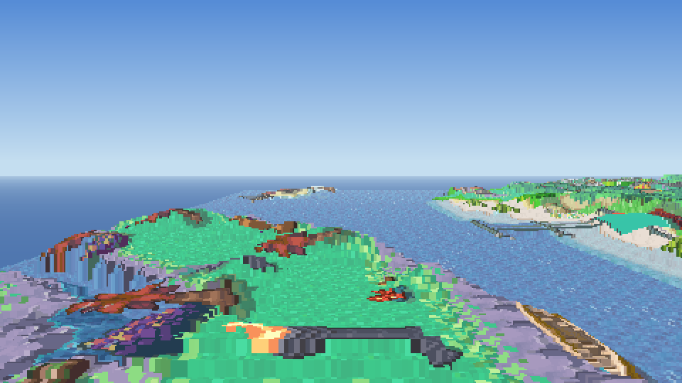

Camera: tile (4, 12), facing east. Mood: sunset.

```
16-bit SNES-era pixel art landscape, crisp hard-edged pixels, limited palette (~48 colours), soft atmospheric depth, JRPG overworld mood, seen from a slightly raised vantage point, no characters, no people, no text, no UI, no watermark, 16:9. On Pleasure Island, looking east across its plateau: grass with a red-earth clearing, red palm trees, flaming stone torches, cliff edges dropping away on both sides. Across the water on the right, the long north beach of the main island. (Pleasure Island is a small tropical island ringed by sheer lavender-grey cliffs, with red-leaved palm trees and stone torches on top.) Palette: vivid green grass, lavender-grey rock, pale sand, deep-blue sea with turquoise shallows. Lighting: warm sunset, pink and orange sky, long shadows.
```

### northeast

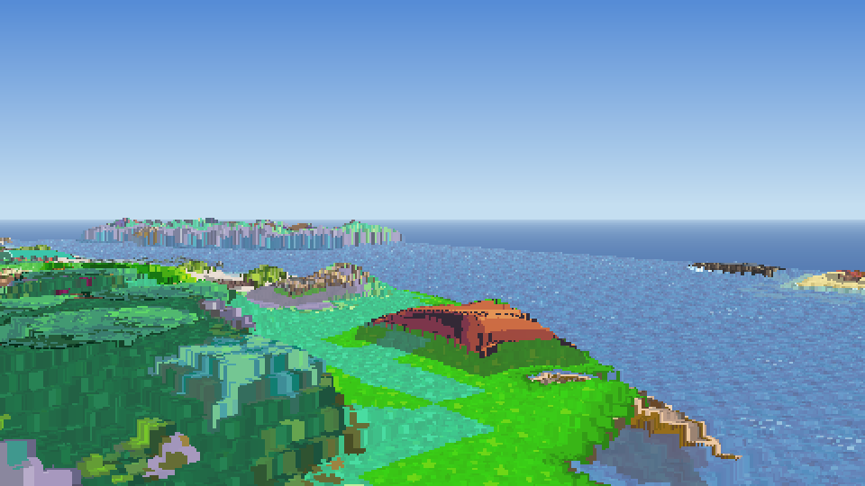

Camera: tile (62, 34), facing northwest. Mood: clear.

```
16-bit SNES-era pixel art landscape, crisp hard-edged pixels, limited palette (~48 colours), soft atmospheric depth, JRPG overworld mood, seen from a slightly raised vantage point, no characters, no people, no text, no UI, no watermark, 16:9. On the north-east headland, looking northwest: a grassy coast with the commanders' red canvas tent and a stone well, the forest edge on the left. Beyond, the sea with two ships and a sandy islet. Palette: vivid green grass, lavender-grey rock, pale sand, deep-blue sea with turquoise shallows. Lighting: bright clear late-morning light, soft shadows, a few white clouds.
```
